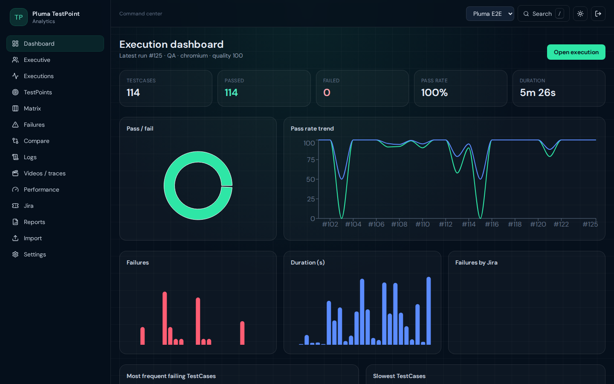
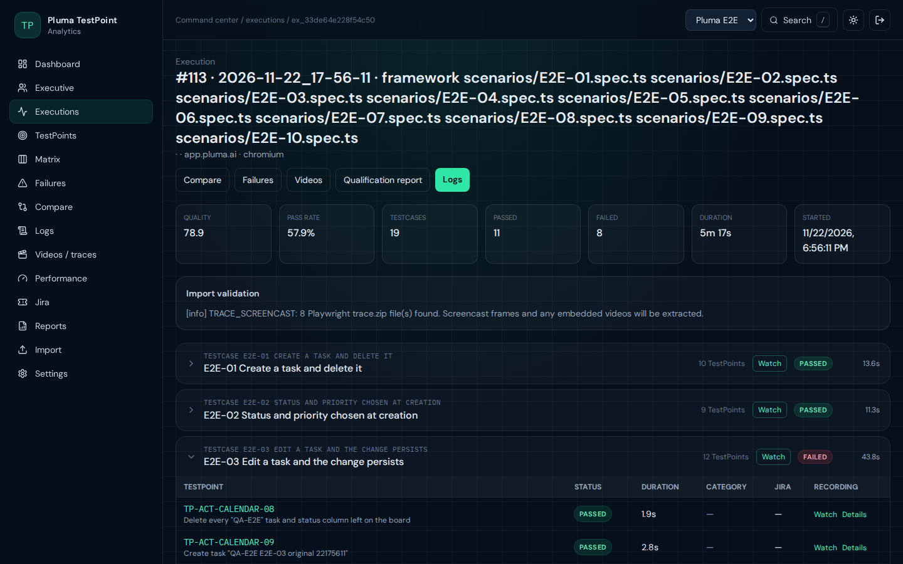
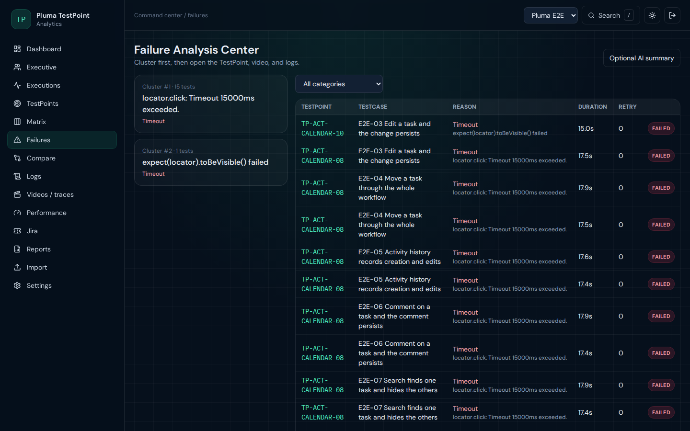
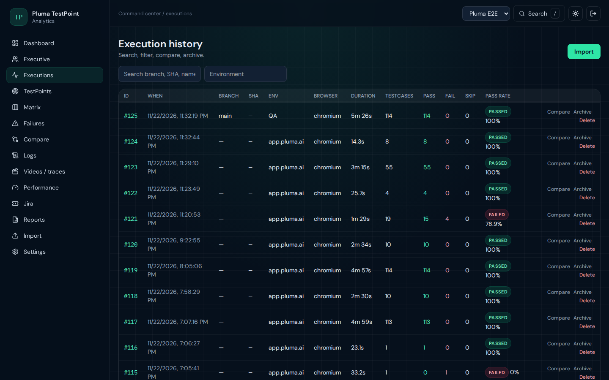
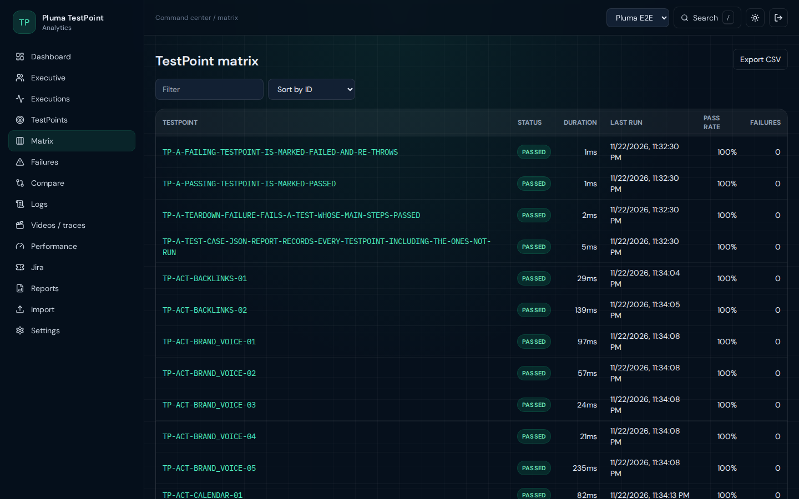
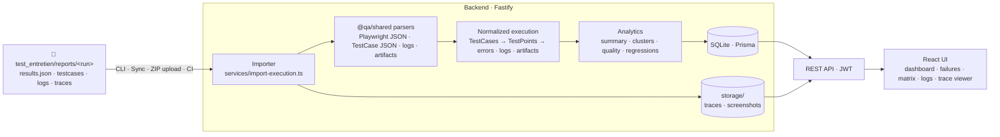

# Pluma Test Analytics

[](https://www.typescriptlang.org)
[](https://react.dev)
[](https://fastify.dev)
[](https://www.prisma.io)
[](https://playwright.dev)


**A command center for Playwright test runs.** It imports every run of the
[Pluma E2E suite](#the-suite-it-analyses) (`test_entretien`) and turns raw reports into something you can act on:
which TestCase failed, at which step, why, how often, and what it looked like when it did.



---

## Contents

1. [Why](#why)
2. [Features](#features)
3. [Quick start](#quick-start)
4. [Importing runs](#importing-runs)
5. [How a run is read](#how-a-run-is-read)
6. [Architecture](#architecture)
7. [Project structure](#project-structure)
8. [Testing](#testing)
9. [Documentation](#documentation)

---

## Why

A Playwright run leaves a folder of JSON, logs, traces and screenshots. That's fine for one run, but it can't answer:

- *Is this failure new, or has it failed in the last five runs?*
- *Do these 15 failures share one cause?*
- *Which step of the TestCase broke, and what was the last step that worked?*
- *Is the suite getting slower?*

This platform stores every run in a database, links each TestCase to its steps (**TestPoints**), logs and traces,
and answers those questions across the run history.

## Features

| | |
|---|---|
| **Execution history** | Every run with pass rate, quality score, duration, and the spec filter it ran with |
| **TestCase → TestPoint tree** | Each test case expanded into its steps, with status, timing, error and *last successful step* |
| **Failure analysis** | Failures grouped by root-cause fingerprint and category (Timeout, Element Not Found, Assertion…) |
| **TestPoint matrix** | Pass rate, failure count and duration of every TestPoint across all runs; CSV export |
| **Logs** | Structured log viewer linked to the TestCase and TestPoint that wrote each line |
| **Traces & screenshots** | `trace.zip` opens in the built-in Playwright Trace Viewer; failure screenshots attached to the step |
| **Compare & regressions** | Diff two runs: new failures, fixed tests, slower steps |
| **Performance** | Slowest TestCases and TestPoints, duration trends |
| **Reports** | Executive summary and a printable qualification report per run |
| **Roles** | `admin`, `qa` and read-only `viewer` users (JWT auth) |

<table>
  <tr>
    <td></td>
    <td></td>
  </tr>
  <tr>
    <td align="center"><sub>One run: TestCases expanded into their TestPoints</sub></td>
    <td align="center"><sub>Failures clustered by root cause</sub></td>
  </tr>
  <tr>
    <td></td>
    <td></td>
  </tr>
  <tr>
    <td align="center"><sub>Execution history</sub></td>
    <td align="center"><sub>Every TestPoint across all runs</sub></td>
  </tr>
</table>

---

## Quick start

**Requirements:** Node.js 20+.

```bash
git clone <this repo> pluma-test-analytics
cd pluma-test-analytics
npm install
cp backend/.env.example backend/.env
npm run build -w shared
npm run db:push
npm run db:seed
npm run dev
```

| | |
|---|---|
| Web UI | http://localhost:5173 |
| API | http://localhost:8787/api/health |
| Login | `admin@qa.local` / `admin123` |
| Other users | `qa@qa.local` / `qa123`, `viewer@qa.local` / `viewer123` |

`db:seed` creates the users and the **Pluma E2E** project, then imports every run it finds in
`../test_entretien/reports` (the suite checked out next to this repo). Point it elsewhere with
`TEST_ENTRETIEN_REPORTS` in `backend/.env`. Without any reports the platform starts empty, and you can upload a run from **Import**.

> Change `JWT_SECRET` and the seeded passwords before exposing the platform outside your machine.

---

## Importing runs

Each `npx playwright test` in the suite writes a new `reports/<YYYY-MM-DD_HH-MM-SS>/` folder. Bring runs in any of these ways:

| How | What it does |
|---|---|
| `npm run import:reports` | Imports every run folder not yet in the project (existing data is kept) |
| `npm run import:reports -- /path/to/reports` | Same, from any folder |
| **Import → Sync reports folder** | Same, from the UI |
| **Import → Import package** | Upload a ZIP of one `reports/<timestamp>` folder (up to 3 GB) |
| `POST /api/ingest/github` (also `gitlab`, `jenkins`) | Upload from CI with an API key ([docs/ci.md](docs/ci.md)) |

Runs where nothing executed (`--list`, every test skipped) and folders with no results are skipped, and the reason is printed.

---

## How a run is read

```
reports/2026-11-22_20-22-55/
├── results.json         Playwright JSON reporter: every test, including ones without TestPoints
├── summary.json         run status and finish time
├── testcases/*.json     one TestCase report with its ordered TestPoints
├── logs/*.log           2026-11-22T20:23:00.493Z [INFO] Running TestPoint TP-ACT-CALENDAR-08: …
├── artifacts/**/        trace.zip, test-failed-1.png, error-context.md
└── html/                Playwright HTML report (not imported)
```

A TestCase report looks like this:

```json
{
  "testCase": "DOC-01 Document status filters and search",
  "scenarioId": "DOC-01",
  "spec": "tests/scenarios/DOC-01.spec.ts",
  "result": "failed",
  "testpoints": [
    { "step": 2, "id": "TP-ACT-DOCUMENTS-01", "description": "Search box is visible", "execution": "passed", "durationMs": 20 },
    { "step": 3, "id": "TP-ACT-DOCUMENTS-02", "description": "Click Status…", "execution": "failed", "error": "locator.click: strict mode violation…" },
    { "step": 4, "id": "TP-ACT-DOCUMENTS-03", "description": "Select the \"Draft\" filter", "execution": "not-run" }
  ]
}
```

Rules the importer applies:

- **TestCase id** is the `scenarioId` (`E2E-01`, `DOC-01`…), falling back to the test title.
- **`not-run`** steps (after the first failure) are recorded as *skipped*.
- **Reused TestPoints are kept separately.** A step such as `TP-ACT-CALENDAR-08` (board cleanup) runs in every E2E case and sometimes twice in one case. Each occurrence keeps its own description, status and timing, so a failure is shown on the case it happened in.
- **Last successful step** is filled in for each failed TestPoint.
- **Framework self-tests** (`tests/framework/*`) fail fake TestPoints on purpose to test the runner. Their fixture reports are ignored and the Playwright result is used.
- **Tests without TestPoints** (unit and framework specs) come from `results.json`, so totals match the suite's own `summary.json`.
- **Logs** are linked line by line to the current TestCase and TestPoint. The older `ISO - LEVEL - message` format is also accepted.

Full reference: [docs/import-format.md](docs/import-format.md).

---

## Architecture



- **`shared/`** is the core, a pure TypeScript library with no I/O. Parsers turn any supported report into one normalized execution model. Analytics (summaries, failure fingerprints and categories, quality score, run comparison, qualification report) run on that model. Both the backend and the tests use it.
- **`backend/`** stores runs (Prisma + SQLite), keeps artifacts on disk, unpacks traces, and serves the API and the Playwright Trace Viewer.
- **`frontend/`** is React + Vite + Tailwind + Recharts.

See [docs/architecture.md](docs/architecture.md) and [docs/data-model.md](docs/data-model.md).

---

## Project structure

```
├── shared/src/
│   ├── parsers/        package.ts (run detection) · playwright-json.ts · testcase-native.ts · logs.ts · artifacts.ts
│   ├── analytics/      summary · error fingerprints · quality score · compare · qualification report
│   └── types.ts        normalized execution model
├── backend/
│   ├── prisma/         schema.prisma
│   └── src/
│       ├── routes/     auth · projects · executions · ingest · reports
│       ├── services/   import-execution.ts · extract-traces.ts
│       ├── lib/        pluma-reports.ts (reports-folder importer) · case-tree.ts · storage
│       ├── seed.ts     users + project + import of the suite's runs
│       └── import-reports.ts
├── frontend/src/       pages · components · lib
├── tests/src/          Vitest suites
└── docs/               architecture · data model · import format · API · CI · analytics
```

---

## Testing

```bash
npm test
```

27 Vitest tests cover the parsers (Playwright JSON, TestCase reports, both log formats, artifact binding),
failure categorization, trace handling and the qualification report. `tests/src/pluma.test.ts` covers the
test_entretien format specifically.

---

## Documentation

| Doc | |
|---|---|
| [import-format.md](docs/import-format.md) | Every file and field the importer reads |
| [architecture.md](docs/architecture.md) | Layers and data flow |
| [data-model.md](docs/data-model.md) | Database entities |
| [api.md](docs/api.md) | REST endpoints |
| [ci.md](docs/ci.md) | Uploading runs from CI |
| [analytics.md](docs/analytics.md) | Quality score, clustering and categories |

---

## The suite it analyses

`test_entretien` is a Playwright + TypeScript E2E suite for [Pluma](https://app.pluma.ai), an AI content and SEO app.
It uses the Page Object Model plus **TestPoints**: small, named, reusable steps such as `TP-ACT-CALENDAR-09` (*create a task*).
Each test is an ordered list of TestPoints, and the suite writes one JSON report and one log per test case. This platform reads those files.
